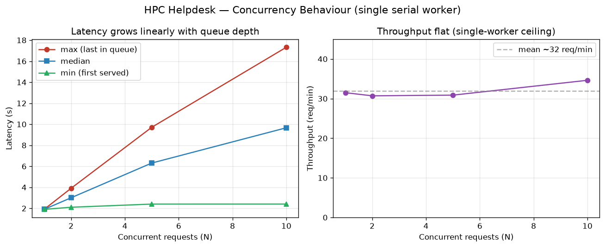

#  SHAREing: High-level performance assessment report

## Setup Details
* Program: DRI-helpdesk-Replication-Guide (RAG HPC helpdesk), tag `assessment-2026-08-v1`
* Parallel model: none in the client; worker is a single-node service on one APU. No MPI, no multithreaded scaling knob exposed.
* Dependencies: llama-index (+ ollama/embeddings/bm25 plugins), python-docx, psutil; Ollama runtime; llama3.1:8b, nomic-embed-text
* Compiler: N/A (interpreted Python; inference via precompiled Ollama runtime)
* Compiler flags: N/A
* Problem spec: 15-query characteristic benchmark (`hpc-helpdesk-standard-benchmark`), submitted sequentially over a shared-filesystem queue

## CPU Analysis
Not applicable. This code performs no user-level floating-point compute on the CPU; its work is document retrieval plus LLM inference dispatched to the AMD MI300A. A scalar-peak FLOPS comparison would not characterise the workload. No CPU score is assigned.

## GPU Analysis
Not measured in this high-level pass. The compute-intensive work (llama3.1:8b inference) runs on the MI300A APU. A meaningful GPU peak-performance-percentage would require profiling the Ollama runtime (e.g. `rocprofiler`/`rocm-smi`) on the worker, which is a deeper study than a high-level black-box glance. The MI300A's unified memory (no separate VRAM) also means the standard "benchmark exceeds GPU cache/VRAM" preparation step needs re-interpretation. Flagged as the primary candidate for follow-up if a deeper rubric is pursued. No GPU score assigned at this stage.

## IO Analysis
Relevant, and the most natural rubric for this architecture: the system is a shared-filesystem queue (requests, responses, token streams) plus index reads.

For a high-level first pass, end-to-end latency was measured from request submission to response file appearing. Total benchmark I/O plus compute for 15 queries was 48.05 s. A precise `C_IO = 1 - (t_read + t_write)/t_total` split requires instrumenting the worker's retrieval/generation vs. queue-wait time (e.g. Darshan or in-worker timers), which is proposed as follow-up. At the high level, queue I/O is not observed to dominate: warm queries complete in ~2–4 s each, consistent with generation time rather than I/O stalls.

IO score: not yet quantified (requires worker-side read/write timing). Preliminary observation: I/O does not appear to dominate runtime.

## Intra-node Analysis
Not applicable as specified. The workbook's intra-node rubric is a strong-scaling study over core counts on a fixed problem. This code exposes no such parallelism: the client is sequential and the worker is a single-process service; there is no thread/core sweep to perform. A conceptually analogous study would be **request concurrency** (multiple simultaneous users on the queue) measuring throughput, but that is a different metric from strong-scaling parallel efficiency and is noted as possible future work. No intra-node score assigned.

## Inter-node Analysis
Not applicable. The code does not run across multiple nodes (no MPI or distributed execution); the worker is bound to a single GPU node. Weak-scaling across nodes cannot be performed. No inter-node score assigned.

## End-to-end latency (primary high-level result)
The characteristic result for this code is response latency:

| Metric | Value |
| -- | -- |
| Queries | 15 |
| Total duration | 48.05 s |
| Cold-start (query 1) | 9.0 s |
| Warm steady-state | ~2–4 s/query (median ~3 s) |
| Timeouts / failures | 0 |
| Client memory (harness only) | ~14 MB |

Measurement caveat: response-time granularity is ~1 s (client polls with
`time.sleep(1)`); true per-query latencies are within ±1 s. Cold-start reflects
model load into the MI300A on first query.

## Summary

These scores are indicative only and cannot be meaningfully compared across
rubrics without domain knowledge. For a RAG helpdesk, most traditional HPC
rubrics do not apply; the meaningful characterisation is end-to-end latency.

| Result | Score | Metric result |
| ---------------- | - | - |
| CPU              | N/A | No user CPU FLOPS workload |
| GPU              | Not measured | Candidate for follow-up (MI300A inference) |
| IO               | Not quantified | I/O does not appear to dominate |
| Intra-node (80%) | N/A | No core-scaling parallelism |
| Inter-node (80%) | N/A | Single-node service |
## Concurrency / Throughput (service scaling study)

Traditional intra/inter-node scaling does not apply to this code, but the
operationally meaningful question for a helpdesk *service* is how it behaves
under simultaneous users. The worker processes requests serially (FIFO, one at
a time — confirmed in `worker.py`: `claim_oldest()` claims a single oldest
request per poll cycle, no request-level threading). We therefore measured
per-request latency and throughput as concurrent load increases.

N requests were submitted simultaneously (via threads) at each concurrency
level, repeating a single representative query
("How do I submit a basic batch job using SLURM?") to isolate the queuing
effect. A warm-up query preceded the sweep to exclude cold-start.

| Concurrency (N) | Batch wall (s) | Min (s) | Median (s) | Max (s) | Throughput (req/min) | Failures |
| --- | --- | --- | --- | --- | --- | --- |
| 1  | 1.91  | 1.90 | 1.90 | 1.90  | 31.5 | 0 |
| 2  | 3.91  | 2.10 | 3.01 | 3.91  | 30.7 | 0 |
| 5  | 9.72  | 2.41 | 6.31 | 9.71  | 30.9 | 0 |
| 10 | 17.33 | 2.41 | 9.66 | 17.33 | 34.6 | 0 |

**Findings:**
- **Throughput is constant at ~31 requests/minute** regardless of concurrency —
  the service capacity of the single-worker design. Concurrent load does not
  increase throughput.
- **Per-request latency grows linearly with queue depth.** The last of 10
  simultaneous requests waits ~17s, sitting behind 9 others (batch wall ≈ N ×
  service time confirms strict serialisation).
- **Zero failures** at all levels: the queue absorbs backlog gracefully;
  requests wait rather than drop.

**Implication:** the current single-worker design is well-behaved but caps
service capacity at ~31 req/min. If concurrent demand routinely exceeds this,
the natural mitigation is multiple workers consuming the same queue — the
architecture (atomic claim via rename) already supports this without
modification.

Note: single-request latency here (~1.9s) is lower than the sequential
benchmark's ~3s, due to finer polling (0.1s vs 1s) and a fully warm model;
the two figures should not be directly compared.
